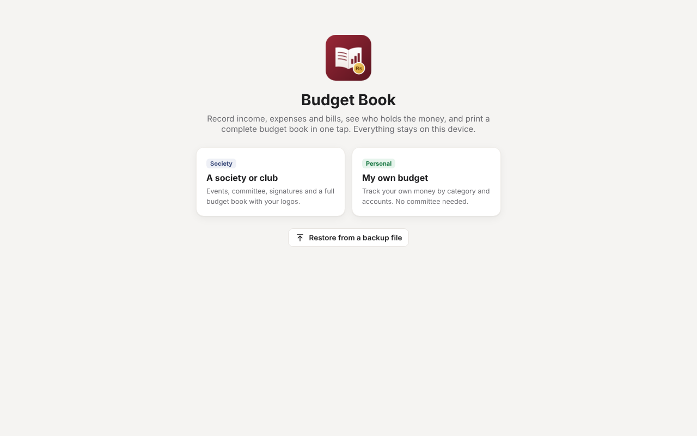

# Budget Book (v2)

Record income, expenses and bills, see who holds the money, print a complete budget book, and sell tickets with QR codes.

   

- **Budget:** works on its own, with your data stored only on your device. Open `index.html`, or put this folder on GitHub Pages.
- **Tickets:** printed ticket books with QR codes, a portal for sellers, an entrance scanner and online sales. These need a free Supabase database; follow **HOSTING.md**.

## Files
- `index.html`: the whole app
- `config.js`: your ticket database address (fill it in after HOSTING.md, Part B step 5)
- `sw.js`, `manifest.json`, `favicon.ico`, `icons/`: let the app install and work offline
- `supabase/schema.sql`: paste into Supabase once
- `supabase/functions/payhere/index.ts`: optional card-payment function

## Install on a phone
Open your site link. On Android (Chrome), tap ⋮ → **Install app**. On iPhone (Safari), tap Share → **Add to Home Screen**.

## Keep your data safe
Save a budget backup often from **Settings → Save backup**. Restore it on any device with **Restore backup**.
